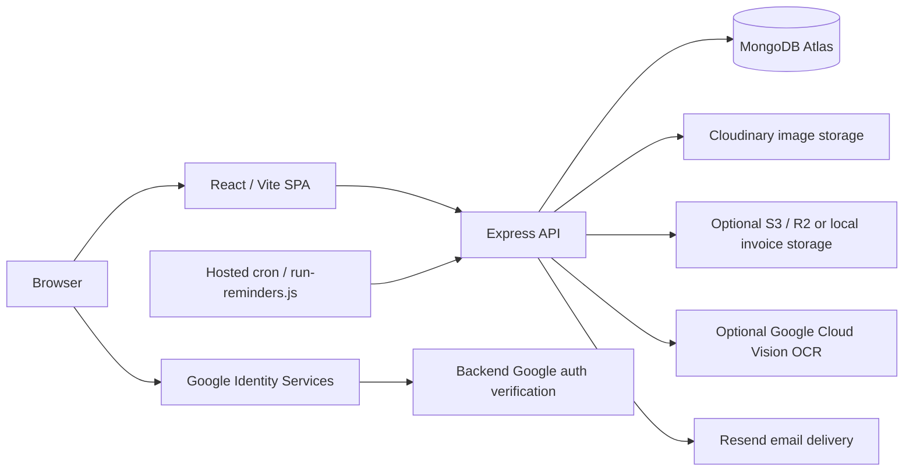

# Warranty Wallet — Project Memory

This file is the single source of truth for the current Warranty Wallet project. It was created from a careful inspection of the source code, manifests, routes, models, services, and non-secret configuration templates. Historical statements supplied by the project owner are labeled as owner-reported where they were not independently verified in this pass.

## A. Project identity and purpose

Warranty Wallet is a full-stack web application for tracking products that a user has purchased. It stores product details, purchase dates, warranty durations, calculated expiry dates, countdowns, warranty status, and invoice/receipt files. It also provides a dashboard showing how many warranties are active, expiring soon, or expired.

Target users are consumers who want to avoid losing receipts, forgetting warranty expiry dates, or missing warranty coverage. A typical workflow is:

1. Register or log in.
2. Add a product with purchase date, warranty duration, category, brand, store, price, serial number, product image, invoice, and notes.
3. View the dashboard status summary and expiring-soon products.
4. Browse, search, filter, and sort all warranties.
5. View a single warranty, open its invoice, update details, or delete it.
6. Upload or remove a profile photo.
7. Receive or trigger expiry reminder notifications.

Current overall status:
- Implemented and locally tested: authentication, warranty CRUD, dashboard statistics, search/filter/sort, invoice uploads, product image search, manual image uploads, profile photos, Cloudinary image storage, Google sign-in flow, notifications, reminders, and environment-loading fixes on the frontend.
- Owner-reported as of latest session: local frontend and backend run, MongoDB Atlas connection was successful, frontend and backend local environment files were created, Cloudinary-hosted product image verification, and Edit Warranty image suggestions after a runtime fix.
- Current status update: Google sign-in now works locally after the backend `.env.local` Google client ID was corrected to match `frontend/.env.local`. The earlier placeholder mismatch is resolved and should be treated as historical context.
- Pending verification: production deployment of recent changes, browser-level end-to-end checks, and corrected local Google OAuth configuration.
- Isolated test-database support is implemented: `USE_TEST_DATABASE=true` selects `warranty_wallet_test`, with hard refusal of production-like environments and the `warranty_wallet` name. Browser E2E is prepared but not run, pending owner approval.
- 2026-11-13 reliability upgrade (verified by automated tests, not by real providers): reminder email delivery now has ownership guards, honest provider status, transient/permanent error classification, timeouts, exponential-backoff retries with an attempt cap, and durable attempt/outcome state. Selected product images are downloaded, validated (MIME allowlist, magic bytes, 5MB limit, SSRF checks), and copied into persistent storage with `productImageMeta` metadata. Test mode (`NODE_ENV=test` or `USE_TEST_DATABASE=true`) still simulates email and forces local image storage even when real credentials are present. Real Resend delivery and real cloud image persistence are **not** verified; see section M.

Project root: `C:\Users\sudheer\OneDrive\Desktop\Warranty Wallet`

Owner-reported repository and deployment links:
- GitHub: `https://github.com/sudheer-bodapati2007/Warranty-Wallet.git`
- Frontend: `https://warranty-wallet-kappa.vercel.app/`
- Backend: `https://warranty-wallet-backend-7jyk.onrender.com`

## B. Technology stack

<|constrain|> Technology | Responsibility | Where it is used | Why it is needed |
| --- | --- | --- | --- |
| React 18 | Builds the frontend user interface | `frontend/src/` | Component-based pages and reusable UI |
| React DOM | Renders React into the browser | `frontend/src/main.jsx` | Mounts the application |
| @react-oauth/google | Google OAuth browser flow and provider | `frontend/src/main.jsx`, `frontend/src/components/GoogleAuthButton.jsx` | Official OIDC sign-in flow |
| React Router DOM | Client-side routing | `frontend/src/App.jsx` | Protected/public routes and deep links |
| Vite | Frontend bundler and dev server | `frontend/vite.config.js`, `frontend/package.json` | Fast local development and production builds |
| Tailwind CSS | Utility-first styling | `frontend/src/index.css`, `tailwind.config.js` | Responsive light/dark UI |
| lucide-react | Icons | Frontend components/pages | Consistent iconography |
| Axios | HTTP requests | `frontend/src/services/api.js` | Wraps API calls and attaches JWT |
| Node.js/Express | Backend HTTP API | `backend/server.js`, controllers | Handles business logic and APIs |
| MongoDB Atlas via Mongoose | Persistent database | `backend/models/`, `backend/config/db.js` | Stores users, warranties, notifications |
| Google Auth Library | Server-side ID token verification | `backend/controllers/authController.js` | Prevents unverified frontend identities |
| JSON Web Token | App session tokens | `backend/middleware/authMiddleware.js` | Bearer authentication for protected routes |
| bcryptjs | Password hashing/comparison | `backend/models/User.js` | Secure email/password authentication |
| Multer | Multipart file upload middleware | `backend/middleware/uploadMiddleware.js` | Accepts product images, invoices, avatars |
| Cloudinary | Image storage | `backend/services/storageService.js` | Persistent profile and product images |
| AWS SDK S3 | S3-compatible file storage | `backend/services/storageService.js` | Uploads/deletes/presigned URLs |
| Helmet | Security headers | `backend/server.js` | Basic HTTP hardening |
| CORS | Cross-origin requests | `backend/server.js` | Allows Vercel frontend to call Render backend |
| express-rate-limit | Auth throttling | `backend/middleware/authMiddleware.js` | Reduces brute force attempts |
| Resend | Email delivery | `backend/services/emailService.js` | Sends warranty reminder emails |
| Node test runner | Backend automated tests | `backend/tests/*.test.js` | Verifies helpers, tests, storage safety |

## C. Architecture and request flow

The frontend is a React single-page application served by Vercel. It calls the Express backend on Render using an API base URL. The backend validates JWTs, accesses MongoDB Atlas through Mongoose, stores images through the storage service, preserves invoice evidence in S3/R2 or local storage, verifies Google ID tokens, optionally calls Google Cloud Vision for OCR, and sends emails through Resend.



Warranty data flow:
1. Add Warranty uploads the invoice first; the backend stores the original bytes and returns a temporary `InvoiceUpload` draft with extraction results.
2. The browser sends confirmed fields to a protected warranty route, referencing `invoiceUploadId` instead of re-uploading the file.
3. `protect` verifies the Bearer JWT and loads the user.
4. `warrantyController` validates fields, calculates `warrantyExpiryDate`, copies the draft evidence onto the warranty, and stores the document scoped to `req.user._id`.
5. The decorated warranty is returned with evidence flags, `recordVersion`, `daysRemaining`, `status`, and `formattedDaysLeft`.
6. The React page displays the result.

Sensitive correction flow:
1. The frontend compares the edited values with the loaded warranty and marks invoice-backed fields.
2. `SecureActionModal` collects a reason and a password or Google ID token.
3. The backend independently re-computes the changes and verifies fresh authentication (`verifyFreshAuthentication`).
4. Old/new values, reason, actor, timestamp, and incremented `recordVersion` are written to the `AuditEvent` collection.
5. A `SECURITY_CORRECTION` notification is created, and email delivery state is recorded honestly.
6. The frontend reloads the audit timeline.

Reminder flow:
1. A hosted cron job or `node scripts/run-reminders.js` runs independently of the web process and exits.
2. `processWarrantyReminders` scans active, non-deleted warranties and selects only the most urgent due interval per warranty.
3. The notification uniqueness index prevents duplicates across repeated runs.
4. Emails are dispatched and their delivery state is stored; failures are retried by the same job.

Image search flow:
1. `useProductImageSearch` debounces the product name/brand query.
2. The frontend calls `GET /api/products/image-search?q=...`.
3. `productImageSearchService` searches Wikimedia Commons and optionally Unsplash.
4. Results are displayed in a gallery.
5. Selecting an image sends `onlineProductImage` during warranty create/update.
6. `downloadAndStoreRemoteImage` validates the source and downloads it through the storage service.
7. For configured Cloudinary, the image is stored in Cloudinary and its secure URL is saved. Without Cloudinary, S3/R2 is used; local disk is only a development/test fallback.
8. `productImageMeta` records storage URL/key, provider, cloud flag, MIME type, size, checksum, source URL, uploader, timestamp, and status.

## D. Folder and file guide

### Root
- `backend/`: Express API, database models, routes, controllers, services, scripts, tests.
- `frontend/`: React/Vite SPA.
- `.gitignore`: Ignores `.env`, local uploads and build outputs.
- `README.md`: Feature overview, local setup, scripts, API summary, and security notes.
- `DEPLOYMENT_GUIDE.md`: Production deployment, scheduling, verification, and rollback checklist.
- `PROJECT_MEMORY.md`: This documentation.
- `AGENTS.md`: Instructions for future AI coding assistants.

### Backend important files
- `backend/server.js`: Loads backend `.env` with dotenv, connects MongoDB, configures Helmet and CORS, mounts routes, serves static uploads, exposes health check.
- `backend/config/db.js`: MongoDB connection configuration; resolves the target through `databaseTarget.js`, refuses unsafe test targets, and redacts connection strings from errors.
- `backend/config/databaseTarget.js`: Test-database selection guard. Keeps production behavior unchanged unless `USE_TEST_DATABASE=true`; supports `MONGODB_URI_TEST`; refuses production-like environments and any database name other than exactly `warranty_wallet_test`.
- `backend/models/User.js`: User identity, password hash, Google ID, avatar URL, timezone, reminder/security preferences.
- `backend/models/Warranty.js`: Warranty schema, invoice evidence subdocument, record version, evidence status, soft-delete timestamp, and owner scoping.
- `backend/models/Notification.js`: Reminder and security notification schema with durable email delivery state.
- `backend/models/AuditEvent.js`: Append-only, owner-scoped audit history.
- `backend/models/InvoiceUpload.js`: Temporary invoice review draft used before a warranty is confirmed.
- `backend/routes/authRoutes.js`: Auth endpoints.
- `backend/routes/warrantyRoutes.js`: Warranty and invoice-evidence endpoints, all protected.
- `backend/routes/notificationRoutes.js`: Notification and cron-triggered reminder endpoints.
- `backend/routes/productRoutes.js`: Image search endpoint, protected.
- `backend/controllers/authController.js`: Registration, login, Google auth, preferences (including timezone/security emails), avatar, avatar deletion.
- `backend/controllers/warrantyController.js`: Warranty CRUD, controlled sensitive updates, soft delete, filtering, stats, invoice access.
- `backend/controllers/warrantyEvidenceController.js`: Invoice extraction draft, integrity verification, replacement/removal, audit history.
- `backend/controllers/notificationController.js`: Notifications and reminder triggers.
- `backend/middleware/authMiddleware.js`: JWT verification and auth rate limiting; selects the password hash for fresh re-authentication.
- `backend/middleware/uploadMiddleware.js`: Multer storage, size/type limits, magic-byte signature validation.
- `backend/middleware/errorHandler.js`: 404 and error handler.
- `backend/services/storageService.js`: Cloudinary/S3/R2/local storage logic; rejects template placeholder credentials and forces local invoice storage when `USE_TEST_DATABASE=true`.
- `backend/services/productImageSearchService.js`: Search, SSRF protection, approved-host checks, strict MIME/magic-byte validation, streaming 5MB limit, and remote image download into storage.
- `backend/services/productImageService.js`: Central product-image durability classification, metadata building, update planning (keep/replace/remove), and failure-safe persistence used by the warranty controller, repair script, and migration script.
- `backend/services/emailService.js`: Escaped expiry/security email templates, injectable test transport, provider timeout and retryable/permanent error classification, honest provider-not-configured failure, and simulated delivery when `NODE_ENV=test` or `USE_TEST_DATABASE=true`.
- `backend/services/notificationService.js`: Security notifications, ownership guard, durable delivery state, exponential-backoff retry scheduling with `MAX_EMAIL_ATTEMPTS = 5`, and the email retry worker.
- `backend/services/reminderService.js`: Timezone-aware expiry reminders with one due interval per run.
- `backend/services/auditService.js`: Append-only audit writes and owner-scoped reads.
- `backend/services/freshAuthService.js`: Server-side password or Google ID-token verification for sensitive actions.
- `backend/services/invoiceEvidenceService.js`: Invoice storage, SHA-256 evidence metadata, draft copying, integrity verification.
- `backend/services/invoiceExtractionService.js`: Local PDF text extraction for page content streams (FlateDecode, ASCII85Decode, ASCIIHexDecode), optional Google Vision OCR, deterministic parsing, and rejection of binary/garbled field values.
- `backend/utils/warrantyHelpers.js`: Expiry, countdown, timezone, and reminder interval logic.
- `backend/utils/controlledEditHelpers.js`: Sensitive field classification and correction reason validation.
- `backend/utils/fileUtils.js`: Checksums, magic-byte detection, path-safe filenames.
- `backend/scripts/migrate-legacy-warranties.js`: Non-destructive legacy ownership migration.
- `backend/scripts/migrate-files-to-cloud.js`: Non-destructive file cloud migration; also writes `productImageMeta` for migrated product images and allows Cloudinary-only image migration.
- `backend/scripts/repair-product-images.js`: Dry-run-by-default, non-destructive repair of legacy external product image URLs. Requires `--execute` for live writes, uses conditional updates, writes `product-image-repair-map.json`, and never deletes the original external URL.
- `backend/scripts/run-reminders.js`: Standalone cron command; uses the guarded `connectDB`, reports email provider status honestly, and reports failed emails.
- `backend/scripts/start-test-server.mjs`: Starts the backend only after the isolated `warranty_wallet_test` target passes the guard.
- `backend/scripts/verify-test-database.mjs`: Read-only test-database connectivity check; prints only hostname and database name and performs no writes.
- `backend/tests/testDatabaseGuard.test.js`: Unit tests for test-database selection and refusal rules.
- `backend/tests/*.test.js`: Backend test suite, currently 158 passing (includes database-guard, email isolation, storage selection, email reliability, and product image persistence tests).

### Frontend important files
- `frontend/src/main.jsx`: React entry; Google OAuth provider and missing-client-ID guard.
- `frontend/src/App.jsx`: Routes, layout, protected routes.
- `frontend/src/context/AuthContext.jsx`: Client auth state and API integration.
- `frontend/src/context/ThemeContext.jsx`: Theme switch.
- `frontend/src/services/api.js`: Axios API methods and file URL helper.
- `frontend/src/components/Navbar.jsx`: Avatar, profile photo modal, logout.
- `frontend/src/components/GoogleAuthButton.jsx`: Official Google sign-in button wrapper.
- `frontend/src/components/ProtectedRoute.jsx`: Route protection.
- `frontend/src/components/WarrantyCard.jsx`: Warranty card display with evidence badge.
- `frontend/src/components/InvoiceReviewPanel.jsx`: Extracted-field review panel for invoice uploads.
- `frontend/src/components/SecureActionModal.jsx`: Reason + fresh-authentication modal for sensitive actions.
- `frontend/src/components/NotificationDrawer.jsx`: Reminders, security alerts, delivery state, preferences, timezone.
- `frontend/src/pages/AddWarranty.jsx`: Invoice-first add flow, extraction review, image search.
- `frontend/src/pages/EditWarranty.jsx`: Controlled edit flow, protected-field badges, secure correction modal.
- `frontend/src/pages/Dashboard.jsx`: Personalized greeting and stats.
- `frontend/src/pages/WarrantyDetails.jsx`: Warranty details, evidence status, integrity verification, invoice replace/remove, audit timeline.
- `frontend/src/pages/MyWarranties.jsx`: Search/filter/sort warranty list.
- `frontend/src/pages/Login.jsx`: Email/password and Google login.
- `frontend/src/pages/Register.jsx`: Registration and Google login.
- `frontend/src/pages/ForgotPassword.jsx`, `ResetPassword.jsx`: Password reset.
- `frontend/src/hooks/useProductImageSearch.js`: Debounced image search hook.
- `frontend/src/utils/formatters.js`: Date/currency/status display helpers.
- `frontend/src/utils/expiry.js`: UTC calendar-aware expiry calculation mirroring the backend.
- `frontend/src/utils/controlledEdit.js`: Client-side sensitive-change detection and idempotency request IDs.
- `frontend/src/utils/fieldLabels.js`: Shared field labels and evidence status labels.

## E. Feature inventory

| Feature | Purpose/Files | Status | Testing |
| --- | --- | --- | --- |
| Email/password auth | `authController.js`, `Login.jsx`, `Register.jsx`, `authMiddleware.js` | Implemented | Auth tests pass |
| Google sign-in | `GoogleAuthButton.jsx`, `authController.googleAuth` | Implemented, owner-reported working locally | Manual owner report |
| User sessions | JWT bearer tokens, `AuthContext.jsx` | Implemented | Automated tests for JWT creation |
| Dashboard stats | `getWarrantyStats`, `Dashboard.jsx` | Implemented | Owner reports |
| Warranty CRUD | `warrantyController.js`, Add/Edit/My/Details pages | Implemented | API/frontend manually tested by owner |
| Soft delete | `deleteWarranty` sets `deletedAt` | Implemented | Covered by controlled-edit/decorate tests |
| Days/Months/Years | `Warranty.warrantyUnit`, forms, `warrantyHelpers.js` | Implemented | 158 backend tests pass |
| Calendar-aware expiry | `calculateExpiryDate`, `frontend/src/utils/expiry.js` | Implemented | Edge cases tested |
| Invoice evidence | `Warranty.invoice`, `invoiceEvidenceService.js` | Implemented | Checksum/integrity tests pass |
| Invoice extraction | `invoiceExtractionService.js`, `InvoiceReviewPanel.jsx` | Implemented; OCR requires external key | Exact sample PDF, compressed streams, garbled-text rejection, and INR tests pass; real OCR provider not run |
| Controlled corrections | `controlledEditHelpers.js`, `SecureActionModal.jsx`, `EditWarranty.jsx` | Implemented | Classification/reason tests pass |
| Fresh re-authentication | `freshAuthService.js` | Implemented | Logic unit-tested indirectly; real Google/password flow needs browser test |
| Audit history | `AuditEvent`, `auditService.js`, `WarrantyDetails.jsx` | Implemented | Append-only tests/verification |
| Security notifications | `notificationService.js`, `emailService.js` | Implemented; real delivery needs provider | Template/state/retry/ownership tests pass; real email not verified |
| Reminder reliability | `reminderService.js`, `run-reminders.js` | Implemented | Timezone/interval tests pass; hosted scheduler not verified |
| Product image search | `productRoutes.js`, `productImageSearchService.js`, `useProductImageSearch.js` | Implemented | Owner reports Add/Edit working |
| Online image selection | Upload modal-like image gallery in Add/Edit | Implemented; selection is downloaded into app storage | Download validation and persistence tests pass |
| Manual image upload | Multer upload and storage service | Implemented | Owner testing reported; storage metadata tested |
| Product image persistence | `productImageService.js`, `storageService.js`, `productImageMeta` | Implemented | Durability, failure, repair-safety tests pass; real cloud upload not verified |
| Profile photo | `updateAvatar`, `deleteAvatar`, Navbar modal | Implemented, locally tested | Owner local test reported |
| Cloudinary | Image asset storage | Implemented | Mocked storage tests pass |
| Owner-scoped warranties | Query by `req.user._id` and `deletedAt: null` | Implemented | Verified in code and tests |
| Loading/error/empty states | Frontend pages/forms | Implemented | Build passes |

## F. Cloudinary documentation

Cloudinary was introduced for persistent product and profile images. Invoices remain excluded from Cloudinary and continue on the existing storage path.

How it works:
- `storageService.isCloudinaryConfigured()` checks environment variables.
- `storeFile(file, folder, userId)` uses Cloudinary for image folders such as `images` and `avatars`.
- Invoices use `invoices`, so they use S3/R2/local fallback rather than Cloudinary.
- Cloudinary uploads use safe unique public IDs and return `secure_url`.
- `deleteStoredFile(fileRef)` detects Cloudinary URLs/public IDs using `getCloudinaryPublicId`.
- Old local/S3/R2 references are handled differently and are not misinterpreted as Cloudinary assets.
- Avatar controller deletes only managed internal/Cloudinary assets, not external Google photo URLs.

Verification: backend storage tests passed and the owner reported Cloudinary-hosted product image URLs. Do not treat Cloudinary as fully production-verified until credentials and real uploads are configured and checked.

## G. Product image search and shared hook

Endpoint: `GET /api/products/image-search?q=...`, protected by auth. Source providers are Wikimedia Commons by default and optionally Unsplash.

Security:
- `isSafePublicHostname` blocks localhost and private/internal addresses.
- `downloadAndStoreRemoteImage` fetches only approved hosts through `isApprovedImageHost` for user-facing selections; the repair script may opt into any public host with `allowAnyPublicHost` after the same SSRF checks.
- It validates protocol, an exact JPEG/PNG/WEBP MIME allowlist, magic bytes matching the declared type, and a streamed 5MB size limit.
- The downloaded bytes are stored through `storageService` and the warranty keeps the resulting app-managed URL plus `productImageMeta`. Temporary third-party URLs are never used as the saved image.
- `downloadAndStoreRemoteImage` returns `{ key, url, isCloud, provider, mimeType, size, checksum, sourceUrl }`.

Frontend:
- `useProductImageSearch` debounces the query for about 500ms.
- It uses a request ID so older results cannot overwrite newer results.
- Add Warranty uses the hook with an optional brand-inclusive query.
- Edit Warranty uses the hook and allows replacement without deleting the old image merely because the product name changed.
- States supported: loading, results, no results, error.

Known fixed bug:
- Previous error: `Uncaught ReferenceError: normalizedQuery is not defined`.
- Root cause: `normalizedQuery` was declared inside `useEffect`, but the dependency array tried to use it in component scope.
- Fix: move query normalization to hook scope.
- Owner reports frontend build passed and backend tests passed 32/32 after the fix.

Persistence behavior (2026-11-13):
- `isDurableProductImageUrl` treats Cloudinary, R2 (`*.r2.dev`), S3 (`*.amazonaws.com`), configured `S3_PUBLIC_DOMAIN`/`R2_PUBLIC_DOMAIN` hosts, and `cloud://` references as durable.
- External provider URLs (Unsplash, Wikimedia, etc.) are not durable and must be downloaded and re-uploaded before saving.
- `planProductImageChange` keeps an existing image during unrelated edits, skips re-uploading an unchanged persisted image, replaces only on a new upload/selection, and removes only on explicit `removeProductImage=true`.
- Replacement uploads the new image first and deletes the old one only after the warranty save succeeds. A failed upload preserves the existing image and returns `imageWarning`.
- Existing records without `productImageMeta` and existing external URLs keep working; `backend/scripts/repair-product-images.js` can migrate them later without deleting originals.

## H. Google OAuth documentation

Frontend:
- `GoogleOAuthProvider` wraps the app in `frontend/src/main.jsx`.
- It uses `VITE_GOOGLE_CLIENT_ID`, with an explicit development warning if missing or placeholder.
- `GoogleAuthButton.jsx` uses `@react-oauth/google` and sends the Google ID token to `POST /api/auth/google`.

Backend:
- `authController.googleAuth` verifies the token with `OAuth2Client.verifyIdToken`.
- It uses `process.env.GOOGLE_CLIENT_ID` as both client ID and audience.
- It requires a verified email.
- It matches or creates users by Google `sub` and verified email.
- It issues the normal app JWT.

Local debugging history:
- Initial reported symptom: `401 invalid_client`.
- Reported likely cause: missing or placeholder frontend `VITE_GOOGLE_CLIENT_ID` or mismatched frontend/backend Google client IDs.
- Owner subsequently reported setting `VITE_GOOGLE_CLIENT_ID` and `GOOGLE_CLIENT_ID` in the same terminal sessions.
- Owner subsequently reported Google sign-in opened Google correctly and returned to the application.
- Current owner report: Google sign-in works locally after correcting `backend/.env.local` to use the same client ID as `frontend/.env.local`.
- No `.env` file contents were inspected during this documentation pass.

Required setup:
- Create a Google Cloud OAuth Web client.
- Use the same client ID in frontend and backend.
- Authorize local and production frontend origins.
- Do not put a client secret in frontend code.
- Do not rely on the frontend to self-declare an identity.

## I. Database and data model

The real `.env` file was not inspected. Database details come from code.

Collections and models:
- `User`: `name`, `email` (unique), `password` (optional if Google), `googleId`, `avatar`, `role`, `resetPasswordToken`, `resetPasswordExpire`, `reminderPreferences` (`emailReminders`, `inAppReminders`, `reminderDays`, `securityEmails`), `timezone`, timestamps.
- `Warranty`: `user`, `productName`, `brand`, `modelNumber`, `category`, `purchaseDate`, `warrantyStartDate`, `warrantyDuration`, `warrantyUnit`, `warrantyExpiryDate`, `store`, `price`, `currency`, `invoiceNumber`, `serialNumber`, `notes`, `productImage` (legacy/active URL kept for compatibility), `productImageMeta`, `invoiceFile` (legacy/active URL), `invoice` (evidence subdocument), `recordVersion`, `evidenceStatus`, `lastCorrectionAt`, `lastCorrectionBy`, `deletedAt`, timestamps.
- `Warranty.productImageMeta`: `storageUrl`, `storageKey`, `provider`, `isCloud`, `mimeType`, `size`, `checksum`, `sourceUrl`, `uploadedBy`, `uploadedAt`, `status` (`persisted`/`local`/`legacy_external`/`unknown`). Optional: existing records may not have it.
- `Warranty.invoice`: `originalName`, `mimeType`, `size`, `checksum` (SHA-256), `storageUrl`, `storageKey`, `isCloud`, `uploadedAt`, `uploadedBy`, `status` (`stored`/`confirmed`/`removed`), `extraction`, `versions[]`, `removedAt`, `removalReason`.
- `Warranty.invoice.versions[]`: preserved evidence metadata for replaced/removed invoices, including previous checksum, storage reference, replacement timestamp/actor, and reason.
- `Notification`: `user`, `warranty`, `title`, `message`, `daysRemaining`, `reminderInterval`, `type` (`EXPIRY_REMINDER` or `SECURITY_CORRECTION`), `details`, `isRead`, `sentEmail`, `dedupeKey`, `emailStatus`, `emailAttempts`, `lastEmailAttemptAt`, `emailProviderId`, `emailError`, `nextEmailRetryAt`, `emailRetryable`, `emailLastErrorCode`, timestamps.
- `AuditEvent`: `user`, `warranty`, `actor`, `actorEmail`, `action`, `changes[]`, `reason`, `recordVersion`, `invoiceId`, `requestId`, `metadata` (`freshAuthMethod`, IP, user agent), timestamps. Application code only creates and reads these documents.
- `InvoiceUpload`: temporary per-user invoice draft with evidence metadata, extraction result, status (`ready`/`consumed`), and optional consumed warranty reference.

Relationships:
- Every warranty belongs to one `User`; `deletedAt` marks soft-deleted records.
- Notification references a user and warranty.
- AuditEvent references a user, warranty, and actor.
- InvoiceUpload references an owner and may reference the warranty that consumed it.

Indexes of note:
- Notification unique `{ user, warranty, reminderInterval }` (security events use unique negative intervals).
- Notification retry/dedupe indexes.
- Warranty owner and `deletedAt` indexes.
- AuditEvent owner/warranty and idempotency indexes.
- InvoiceUpload owner/status indexes.

Possible issue: Some pre-existing warranties may not have a `user` field. The code and migration scripts avoid silently assigning all such records to one user unless an explicit owner email is supplied and `--execute` is used.

## J. API reference

All paths are relative to the API base, usually `/api`.

Health:
- `GET /api/health`

Authentication:
- `POST /api/auth/register`
- `POST /api/auth/login`
- `POST /api/auth/google`
- `POST /api/auth/logout`
- `POST /api/auth/forgot-password`
- `PUT /api/auth/reset-password/:resetToken`
- `GET /api/auth/me` (auth)
- `PUT /api/auth/preferences` (auth)
- `PUT /api/auth/avatar` (auth, multipart `avatar`)
- `DELETE /api/auth/avatar` (auth)

Warranties:
- `GET /api/warranties` (auth, optional `search`, `category`, `status`, `sort`)
- `GET /api/warranties/stats` (auth)
- `GET /api/warranties/:id` (auth)
- `POST /api/warranties` (auth, multipart `productImage`, `invoiceFile`, or `invoiceUploadId`)
- `PUT /api/warranties/:id` (auth, ordinary fields only; rejects `invoice`, `invoiceFile`, `removeInvoiceFile`, and server-managed fields)
- `DELETE /api/warranties/:id` (auth, soft delete; evidence retained)
- `GET /api/warranties/:id/invoice` (auth)
- `GET /api/warranties/:id/invoice-url` (auth, signed URL when cloud storage is configured)
- `POST /api/warranties/invoice/extract` (auth, multipart `invoiceFile`; stores a review draft)
- `GET /api/warranties/:id/invoice/verify` (auth, checksum integrity result)
- `POST /api/warranties/:id/invoice/replace` (auth, multipart `invoiceFile` + `reason` + fresh auth)
- `DELETE /api/warranties/:id/invoice` (auth, `reason` + fresh auth; marks removed)
- `GET /api/warranties/:id/audit` (auth, owner-scoped append-only history)

Sensitive correction payloads:
- `PUT /api/warranties/:id` accepts `correctionReason`, `requestId`, and either `freshPassword` or `freshGoogleCredential` when invoice-backed sensitive fields change.
- A repeated `requestId` returns the existing result instead of duplicating audit events or notifications.
- Invoice replacement/removal accepts `reason`, `requestId`, and either `freshPassword` or `freshGoogleCredential`.

Products:
- `GET /api/products/image-search?q=...` (auth)

Notifications:
- `POST /api/notifications/process-reminders` (cron secret or auth)
- `GET /api/notifications` (auth)
- `DELETE /api/notifications` (auth)
- `PUT /api/notifications/:id/read` (auth)
- `PUT /api/notifications/read-all` (auth)
- `DELETE /api/notifications/:id` (auth)

Responses generally follow `{ success, message, data, count }` where relevant.

## K. Environment configuration and secret safety

Frontend environment variables:
- `VITE_API_URL`
- `VITE_GOOGLE_CLIENT_ID`

Backend environment variables:
- `PORT`
- `NODE_ENV`
- `CLIENT_URL`
- `MONGODB_URI`
- `JWT_SECRET`
- `JWT_EXPIRE`
- `GOOGLE_CLIENT_ID`
- `CLOUDINARY_CLOUD_NAME`
- `CLOUDINARY_API_KEY`
- `CLOUDINARY_API_SECRET`
- `CLOUDINARY_UPLOAD_FOLDER`
- S3/R2 variables if used
- `RESEND_API_KEY`
- `EMAIL_FROM`
- `CRON_SECRET`
- `GOOGLE_VISION_API_KEY` (optional OCR)
- `USE_TEST_DATABASE` (process-only local test flag; never set on Render)
- `MONGODB_URI_TEST` (optional dedicated test URI; read only when `USE_TEST_DATABASE=true`)

Safety rules:
- Never put secrets in frontend `VITE_` variables.
- Vite variables are bundled into browser JavaScript and are not private.
- Backend secrets remain server-side.
- The actual `.env` files are ignored by `.gitignore`, and their contents were not inspected for this documentation.
- The local backend and Render production both use the Atlas database name `warranty_wallet`. Browser tests must use the isolated `warranty_wallet_test` selection described in section L.

Current environment-loading audit:
- Frontend uses Vite native environment files.
- Backend now loads `backend/.env.local` before `backend/.env` using `dotenv.config({ path: ... })`.
- The owner created `frontend/.env.local` and `backend/.env.local` from the provided examples.
- A temporary mismatch previously caused Google login to fail because `backend/.env.local` contained the placeholder Google client ID.
- The owner now reports that Google sign-in works locally after correcting the backend value to match the frontend value.
- Do not open or print the real `.env.local` files; inspect only templates and source-safe configuration references.

## L. Local runbook

Prerequisites:
- Node.js v18 or newer recommended.
- MongoDB connection, usually MongoDB Atlas.
- Optional credentials for Google OAuth, Cloudinary, S3/R2, Resend, and Google Cloud Vision OCR.

Backend:
```powershell
cd backend
npm install
npm run dev
```
Starts at `http://localhost:5000` by default. This uses the configured production database name `warranty_wallet`; do not use it for browser tests.

Isolated test backend (safe for browser E2E, no credentials in shell history):
```powershell
cd backend
$env:USE_TEST_DATABASE = 'true'
npm run db:test:check
npm run dev:test
```
The process only starts when the resolved database is exactly `warranty_wallet_test`, and it refuses production-like environments. Stop with `Ctrl+C`, then `Remove-Item Env:USE_TEST_DATABASE`.

Frontend:
```powershell
cd frontend
npm install
npm run dev
```
Starts at `http://localhost:5173` by default.

Tests:
```powershell
cd backend
npm test
```

Reminder job (one pass, then exits):
```powershell
cd backend
npm run reminders
```

Frontend build:
```powershell
cd frontend
npm run build
```

Health check:
```powershell
Invoke-WebRequest -Uri "http://localhost:5000/api/health" -UseBasicParsing
```

Useful troubleshooting:
- If `npm run dev` uses outdated variables, restart after changing environment files.
- If backend cannot connect to MongoDB, verify `MONGODB_URI`.
- If Google sign-in says `invalid_client`, verify the exact frontend and backend client IDs and authorized origins.
- If frontend is blank with `ReferenceError`, inspect the browser console and fix the named variable.

## M. Testing and verification ledger

| Check | Latest result | Source/evidence | Remaining |
| --- | --- | --- | --- |
| Backend tests | 158/158 passing — tests 158, suites 38, pass 158, fail 0, cancelled 0, skipped 0, todo 0, duration 2244.6765 ms (2026-11-13 final verification) | `npm test` in `backend` (exit code 0) | Rerun after each change |
| Frontend build | Passed — Vite 6.4.4, 1582 modules transformed, `dist/index.html` 1.06 kB, CSS 44.40 kB, JS 444.05 kB, built in 38.66 s (2026-11-13 final verification) | `npm run build` in `frontend` (exit code 0) | Rerun after each meaningful change |
| Test-mode isolation re-verification | 69/69 passing — tests 69, suites 14, pass 69, fail 0, skipped 0, duration 2987.7575 ms, with `USE_TEST_DATABASE=true` set in the process environment | `node --test tests/testDatabaseGuard.test.js tests/emailIsolation.test.js tests/emailReliability.test.js tests/productImagePersistence.test.js tests/storageService.test.js tests/cloudinaryStorage.test.js` in `backend` | Recheck whenever the guard or storage/email selection logic changes |
| Isolated test database selection | Guard tests pass; `npm run db:test:check` connected successfully | Resolved `warranty_wallet_test` on the configured Atlas cluster; only metadata printed; no writes | Browser E2E awaits owner approval |
| Test suite database usage | No real database connection; unit/model-level only | Grep of `backend/tests/*.test.js` found no `mongoose.connect`, `.save()`, or `.create()`. `testDatabaseGuard.test.js` sets fake `MONGODB_URI` strings but never connects | Confirm again after adding DB-backed tests |
| Invoice extraction (text PDF) | Passing unit tests, including the exact `sample_warranty_wallet_invoice.pdf` fixture and ASCII85+Flate streams | `backend/tests/invoiceExtraction.test.js`, `backend/tests/fixtures/sample_warranty_wallet_invoice.pdf` | Real scanned/OCR invoice not tested |
| Invoice checksum/integrity | Passing unit tests | `backend/tests/invoiceIntegrity.test.js` | Production storage verification pending |
| Controlled editing rules | Passing unit tests | `backend/tests/controlledEdit.test.js` | Browser-level correction flow pending |
| Security email templates/state | Passing unit tests | `backend/tests/securityEmail.test.js` | Real Resend delivery not verified |
| Email isolation in test database mode | Passing unit tests | `backend/tests/emailIsolation.test.js` | Confirms no Resend call when `USE_TEST_DATABASE=true`, even with a key configured; normal development behavior unchanged |
| Email delivery reliability | Passing unit tests | `backend/tests/emailReliability.test.js` | Recipient/ownership guards, success/failure, timeout, retryable vs permanent errors, backoff cap, attempt cap, test-mode isolation, and cron entry-point source checks. Real Resend delivery not verified |
| Product image persistence | Passing unit tests | `backend/tests/productImagePersistence.test.js` | Durable/local classification, update planning, storage/download failure preservation, test-mode local storage, MIME/magic-byte/size/host rejection, metadata schema compatibility, and repair-script safety. Real cloud upload not verified |
| Cloud storage configuration validation | Passing unit tests | `backend/tests/storageService.test.js` | Placeholder credentials are rejected and test-database uploads stay on local disk; real cloud delivery still needs valid credentials |
| Reminder scheduling/timezones | Passing unit tests | `backend/tests/reminderScheduling.test.js` | Hosted scheduler not verified |
| Backend health | Returned success JSON | Previously reported local test | Repeat after env changes |
| Google sign-in | Owner reports working locally | Owner report | Production configuration remains separate |
| Warranty create/edit/view/delete | Owner reported working; new UI not browser-tested in this pass | Owner manual testing plus new build | Browser end-to-end review of invoice flows |
| Fresh re-authentication | Implemented and unit-adjacent tested | Code inspection and frontend build | Real password/Google modal test pending |
| Profile photo upload | Owner reported working | Owner manual testing | Production persistence check |
| Cloudinary product image | Owner reported Cloudinary URL | Owner report | Real credential verification pending |
| Image search in Add/Edit | Fixed environment and hook errors | Earlier verification history | Browser manual check recommended |

Explicitly not run in this pass:
- Real Resend email delivery (email tests use an injected transport or simulated test mode).
- Real Cloudinary/S3/R2 product image upload (storage tests use local test mode and mocks).
- Real Google Cloud Vision OCR.
- Production Render cron execution.
- Production MongoDB index creation.
- Browser-level end-to-end tests.
- Any write to `warranty_wallet` or `warranty_wallet_test`.
- `repair-product-images.js --execute` or `migrate-files-to-cloud.js --execute`.

No claim is made that the entire application is fully production-verified.

## N. Deployment and hosting history

Owner-reported hosting architecture:
- Frontend on Vercel.
- Backend on Render.
- MongoDB Atlas.
- Optional R2/S3 object storage.
- Resend for email.

Owner-reported URLs:
- Frontend: `https://warranty-wallet-kappa.vercel.app/`
- Backend: `https://warranty-wallet-backend-7jyk.onrender.com`
- GitHub: `https://github.com/sudheer-bodapati2007/Warranty-Wallet.git`

CORS handling:
- `CLIENT_URL` can contain comma-separated allowed origins.
- In production, the selected Vercel origin must be allowed.
- Frontend must use the correct `VITE_API_URL`.

Deployment steps and rollback details are in `DEPLOYMENT_GUIDE.md`.

## O. Development history

- 2026-10-06: Initial Warranty Wallet project committed.
- 2026-10-06: Backend prepared for Render deployment in the second commit.
- Subsequent project work in October 2026 advanced authentication, dashboard UI, warranty CRUD, uploads, notifications, and other major features.
- Google OAuth was implemented and debugged until the owner reported local sign-in working.
- Warranty duration support expanded to Days, Months, and Years.
- Expiry calculation was made calendar-aware for month-end and leap-year dates.
- Dashboard greeting became personalized by local time.
- Product image search was added to Add Warranty and later reused in Edit Warranty.
- A shared `useProductImageSearch` hook was added and a `normalizedQuery` runtime error was fixed.
- Profile photo upload/replacement/removal was implemented with the existing storage architecture.
- Cloudinary image storage was integrated for profile and product images while invoices remained on the existing storage path.
- Invoice-backed warranty evidence was added: SHA-256 checksums, original metadata, draft review before save, local PDF extraction, optional OCR, controlled sensitive corrections, append-only audit history, security notifications, soft delete, and timezone-aware reminder scheduling.
- The frontend gained invoice review, secure-action modal, evidence badges, integrity verification, invoice replacement/removal, audit timeline, security alert display, delivery-state badges, security-email preference, and timezone setting.
- Environment-loading behavior was audited and frontend missing/placeholder Google client ID handling was improved.
- Email sending and invoice storage were isolated for test-database mode; template placeholder storage values are rejected and test uploads stay on local disk.
- 2026-11-13: Invoice extraction was hardened after a browser test. The local extractor now reads page content streams encoded with ASCII85Decode + FlateDecode, skips embedded binary metadata, rejects binary/garbled field values, recognises INR/₹/Rs/Rupees, and extracts the exact sample invoice correctly. Regression tests cover the sample fixture, compressed streams, garbled text, INR detection, missing fields, extraction failure with checksum retention, and mocked OCR.
- 2026-11-13: Email and product-image reliability upgrade. Email dispatch gained recipient validation, an ownership guard, provider timeout handling, retryable/permanent error classification, exponential-backoff retry scheduling with an attempt cap, and durable attempt/outcome fields on `Notification`. Product image selection now downloads, validates (MIME allowlist, magic bytes, streamed 5MB limit, SSRF checks), and copies images into app-managed storage, recording `productImageMeta`. A new dry-run-by-default `repair-product-images.js` can migrate legacy external image URLs without deleting originals. Test-mode isolation was extended to Cloudinary image uploads. Backend suite: 158/158 passing; frontend build passes. Real provider delivery/persistence was not verified.
- Project-memory and AI-agent instruction files were added.

Exact dates for many intermediate work items were not independently verified, and any unsourced date should be treated as approximate.

## P. Known issues, risks, and limitations

- Real OAuth production configuration is separate from local configuration.
- Historical issue resolved: Google login previously failed locally because `backend/.env.local` contained the placeholder Google client ID while `frontend/.env.local` contained the real one. The owner reports it now works after correcting the backend file.
- Cloudinary production behavior is not independently verified without credentials.
- Existing uploaded local/S3/R2 files were not migrated to Cloudinary.
- Some legacy warranty records may not have owner fields.
- Users can access only their own warranties; ownership migration for legacy records must be explicit.
- Frontend variables prefixed with `VITE_` are public and must not contain secrets.
- The actual `.env` files were never inspected during this project-memory task.
- The application has not been independently production-verified after the latest changes; local build/test results may differ in deployment.
- Real OCR requires `GOOGLE_VISION_API_KEY`; without it, scanned/image invoices are stored but not read automatically.
- Real email delivery requires `RESEND_API_KEY` and `EMAIL_FROM`; without them, notifications retain a failed/pending delivery state. Failed sends are retried with exponential backoff up to 5 attempts, but delivery is never claimed unless the provider accepted the message.
- Product image durability in production requires Cloudinary or S3/R2. Without it, images fall back to local disk, which is not durable across restarts/redeploys; the storage service logs a warning in production.
- S3/R2 image URLs need `S3_PUBLIC_DOMAIN`/`R2_PUBLIC_DOMAIN` (or a public bucket URL) to be browser-renderable. `cloud://` references are not directly renderable.
- Legacy external product image URLs still render but may expire. `repair-product-images.js` is the non-destructive migration path; it has not been executed against production.
- Real provider verification (Resend delivery, Cloudinary/S3/R2 upload) was not performed in this pass; all related tests use injected transports, mocks, or local test-mode storage.
- Production reminder scheduling depends on the hosted cron configuration, not on the backend staying awake.
- Invoice extraction is deterministic and intentionally conservative; missing fields remain missing.
- The append-only audit log is protected by application APIs but not cryptographically immutable against direct database access.
- Existing records without invoice checksums are labeled `legacy_unverified` rather than given fabricated evidence.
- Local backend storage variables currently contain template placeholders without an R2/S3 endpoint. Placeholder values are now rejected so new invoice uploads fall back to local disk; real cloud storage still requires valid credentials and the correct endpoint.

## Q. Pending tasks and roadmap

1. Completed in the invoice-evidence upgrade (verified by source inspection and automated tests)
   - [x] Invoice evidence subdocument with filename, MIME type, size, uploader, timestamp, storage reference, and SHA-256 checksum.
   - [x] Draft-based invoice review before warranty confirmation (no double upload).
   - [x] Local text-PDF extraction and deterministic parsing; missing fields stay missing.
   - [x] Invoice extraction hardening (2026-11-13): compressed page streams, garbled-value rejection, INR recognition, and exact sample PDF regression coverage.
   - [x] Optional Google Cloud Vision OCR path when `GOOGLE_VISION_API_KEY` is configured.
   - [x] Controlled sensitive corrections with reason validation, server-verified fresh auth, record version increment, audit event, and owner notification.
   - [x] Append-only, owner-scoped audit history.
   - [x] Invoice replacement/removal with preserved previous versions and retained original bytes.
   - [x] Soft-delete behavior that preserves invoice evidence.
   - [x] Timezone-aware reminder scheduling, one due interval per run, duplicate-safe indexing, and durable email retry state.
   - [x] Backend test suite expanded to 101 passing tests at that time (now 158/158 after the reliability upgrade).
   - [x] Frontend production build passes.

2. Email and product-image reliability upgrade (2026-11-13; verified by automated tests only)
   - [x] Email sends only to the notification owner with an ownership guard against cross-user leakage.
   - [x] Provider timeout handling; transient errors retry with exponential backoff (5 min doubling, capped at 6 h); permanent errors stop retrying.
   - [x] Attempt cap `MAX_EMAIL_ATTEMPTS = 5`; failed attempts are never marked delivered.
   - [x] Durable state: `emailAttempts`, `emailStatus`, `emailError`, `emailLastErrorCode`, `emailRetryable`, `nextEmailRetryAt`.
   - [x] In-app notifications remain independent of email success.
   - [x] Unconfigured provider is reported honestly instead of pretending delivery.
   - [x] Selected online images are downloaded, validated (MIME allowlist, magic bytes, streamed 5MB limit, SSRF checks), and stored in app-managed storage.
   - [x] `productImageMeta` records storage URL/key, provider, cloud flag, MIME type, size, checksum, source URL, uploader, timestamp, and status.
   - [x] Failed uploads preserve the existing image and return `imageWarning`; old images are deleted only after a successful save.
   - [x] Unrelated edits keep the existing image; unchanged persisted images are not re-uploaded.
   - [x] Legacy external URLs keep rendering; `repair-product-images.js` is dry-run by default and never deletes originals.
   - [x] Test mode forces local image storage and simulated email even with real credentials present.
   - [x] New tests: `emailReliability.test.js`, `productImagePersistence.test.js`; suite now 158/158 passing.
   - [ ] Real Resend delivery and real Cloudinary/S3/R2 uploads still need provider credentials and a manual verification run.

3. Isolated test database preparation (completed; verified without writes)
   - [x] `backend/config/databaseTarget.js` selects `warranty_wallet_test` only when `USE_TEST_DATABASE=true`.
   - [x] Hard refusal for `warranty_wallet`, wrong database names, `NODE_ENV=production`, and Render environments.
   - [x] `npm run dev:test` starts the backend only after the guard passes.
   - [x] `npm run db:test:check` confirmed connectivity to `warranty_wallet_test` and printed only hostname and database name.
   - [x] No `.env`/`.env.local` file was read, modified, or required to change; no Render setting was touched.
   - [ ] Owner approval still required before browser E2E tests run.

4. Browser-level verification still required
   - [ ] Start the backend with `$env:USE_TEST_DATABASE='true'; npm run dev:test` and confirm the `TEST DATABASE: warranty_wallet_test` log line.
   - [ ] Add Warranty with a text PDF invoice: confirm extraction suggestions, edit a value, save, and reopen.
   - [ ] Add Warranty with an image invoice when OCR is not configured: confirm manual fallback works.
   - [ ] Edit an invoice-backed field: confirm the secure modal collects a reason and fresh auth, then verify the audit event and security notification.
   - [ ] Replace an invoice: confirm the previous version appears in history and the checksum verification works.
   - [ ] Remove an invoice: confirm it is marked removed, cannot be viewed, and the original bytes remain.
   - [ ] Verify the invoice integrity action reports match/mismatch correctly.
   - [ ] Verify the audit timeline renders for each action type.
   - [ ] Verify Notification Drawer security alerts, delivery badges, security-email preference, and timezone save.
   - [ ] Verify the evidence badge appears on warranty cards.

5. Local environment configuration
   - [ ] Set `VITE_GOOGLE_CLIENT_ID` to the real frontend Google client ID.
   - [ ] Set backend `GOOGLE_CLIENT_ID` to the same value.
   - [ ] Authorize local frontend origin in Google Cloud Console.
   - [ ] Set database and storage variables for the backend.
   - [ ] Optionally set Cloudinary variables.
   - [ ] Optionally set `GOOGLE_VISION_API_KEY` for OCR.
   - [ ] Set `RESEND_API_KEY` and `EMAIL_FROM` for real email delivery.

6. External-service verification (cannot be completed without credentials)
   - [ ] Send a real test email and confirm it arrives before claiming delivery works.
   - [ ] Upload a real scanned invoice and confirm OCR output with `GOOGLE_VISION_API_KEY`.
   - [ ] Confirm Cloudinary upload and deletion behavior with real configured credentials.
   - [ ] Confirm a selected online product image is re-uploaded to persistent storage and still renders after a backend restart/redeploy.
   - [ ] Confirm a transient email failure is retried and a permanent failure stops retrying, using a real provider.
   - [ ] Confirm profile and product images use Cloudinary when configured.
   - [ ] Confirm invoices never use Cloudinary.

7. Production verification (requires deployment access and owner approval)
   - [ ] Confirm MongoDB Atlas created the declared indexes, including the notification uniqueness index.
   - [ ] Run the hosted reminder cron and confirm one pass works without duplicates.
   - [ ] Confirm the scheduler runs independently of the backend web process staying awake.
   - [ ] Confirm real email retry state transitions in production.
   - [ ] Review CORS origin configuration.
   - [ ] Verify soft-deleted records and invoice evidence remain in the production database.

8. Regression testing
   - [ ] Run backend tests after each change.
   - [ ] Run the frontend production build after each change.
   - [ ] Run lint if available.
   - [ ] Recheck warranty CRUD, image search, profile photos, notifications, and themes.

9. Deployment tasks requiring explicit owner approval
   - [ ] Do not deploy frontend.
   - [ ] Do not deploy backend.
   - [ ] Do not change environment variables in hosting dashboards unless approved.
   - [ ] Do not run migration scripts without approval.
   - [ ] Do not purge invoice files or audit records.

10. Optional future improvements
   - [ ] Add browser-level automated tests.
   - [ ] Add rate limiting to more routes.
   - [ ] Improve ownership migration administration.
   - [ ] Add a documented evidence retention/purge policy (owner decision).

## R. START HERE — NEXT SESSION

Current status: Warranty Wallet is a working full-stack application with authentication, warranty CRUD, dashboard statistics, Google OAuth, image search, profile photos, Cloudinary image storage, invoice-backed evidence, controlled sensitive corrections, append-only audit history, security notifications, timezone-aware reminders, reliable reminder-email delivery state, and durable product-image persistence. Backend tests pass 158/158 and the frontend production build passes. The local backend has an opt-in `warranty_wallet_test` mode that refuses production-like environments and any other database name. These are local results; external services and production behavior are not fully verified.

Most recently completed task (2026-11-13): email and product-image reliability upgrade. Added `backend/services/productImageService.js`, `backend/scripts/repair-product-images.js`, `backend/tests/emailReliability.test.js`, and `backend/tests/productImagePersistence.test.js`; hardened `emailService.js`, `notificationService.js`, `reminderService.js`, `storageService.js`, `productImageSearchService.js`, `warrantyController.js`, `models/Warranty.js`, `models/Notification.js`, `scripts/run-reminders.js`, and `scripts/migrate-files-to-cloud.js`. No `.env`/`.env.local` file was read or modified, no production data was touched, and nothing was committed, pushed, or deployed.

Final verification (2026-11-13): `npm test` in `backend` exited 0 with tests 158, suites 38, pass 158, fail 0, cancelled 0, skipped 0, todo 0, duration 2244.6765 ms. `npm run build` in `frontend` exited 0 with Vite 6.4.4 transforming 1582 modules in 38.66 s. A focused isolation run with `USE_TEST_DATABASE=true` in the process environment passed 69/69 tests (14 suites, 0 fail, 2987.7575 ms), covering the test-database guard, simulated email, and forced-local image storage. No real email was sent and no real cloud upload occurred.

Exact next action: (a) optionally configure real `RESEND_API_KEY`/`EMAIL_FROM` and Cloudinary or S3/R2 credentials in the owner-controlled environment, then manually verify one real reminder email and one real product-image upload; (b) after owner approval, start the backend with `$env:USE_TEST_DATABASE = 'true'; npm run dev:test` and browser-test the invoice and image flows against `warranty_wallet_test` only. Do not start browser tests or provider verification until the owner approves.

Likely files for the next session: `backend/services/emailService.js`, `backend/services/notificationService.js`, `backend/services/productImageService.js`, `backend/services/storageService.js`, `backend/scripts/repair-product-images.js`, `backend/config/databaseTarget.js`, `frontend/src/pages/AddWarranty.jsx`, `frontend/src/pages/EditWarranty.jsx`, `frontend/src/pages/WarrantyDetails.jsx`, and `frontend/src/components/NotificationDrawer.jsx`.

How to verify success:
1. `npm test` in `backend` reports 158/158 passing.
2. `npm run build` in `frontend` succeeds.
3. `npm run db:test:check` reports `databaseName: "warranty_wallet_test"` and `ok: true`.
4. The backend starts with `npm run dev:test` and logs `TEST DATABASE: warranty_wallet_test`.
5. Starting with `USE_TEST_DATABASE=true` while `NODE_ENV=production` or with the `warranty_wallet` name is refused.
6. A text PDF invoice upload produces review suggestions without inventing missing fields.
7. Saving an invoice-backed warranty preserves the checksum and lets you verify it.
8. Editing an invoice-backed field requires a reason and fresh authentication, then shows in the audit timeline and creates a security notification.
9. Replacing/removing an invoice preserves previous evidence and does not delete the original bytes.
10. A selected online image is saved under `/uploads/...` in test mode or a Cloudinary/S3/R2 URL in configured development, with `productImageMeta.status` matching the real location.
11. `node backend/scripts/repair-product-images.js --dry-run` reports external URLs and changes nothing.

Tasks that must not be started until owner approves:
- Any deployment.
- Any production environment-variable or secret change.
- Any database migration or file migration with `--execute`.
- Any destructive file or record deletion.
- Any push, commit, or remote configuration change.
- Any cleanup of legacy local uploads or invoice evidence.
- Any browser E2E test run, even against `warranty_wallet_test`.
- Any `repair-product-images.js --execute` or `migrate-files-to-cloud.js --execute` run.
- Any real email send or real cloud upload used for verification.
